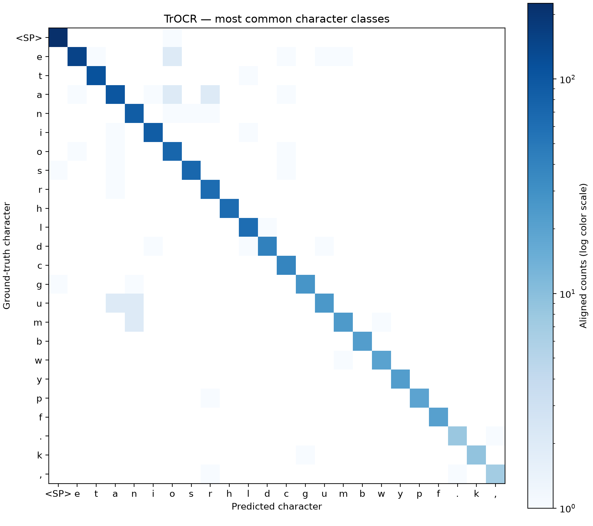
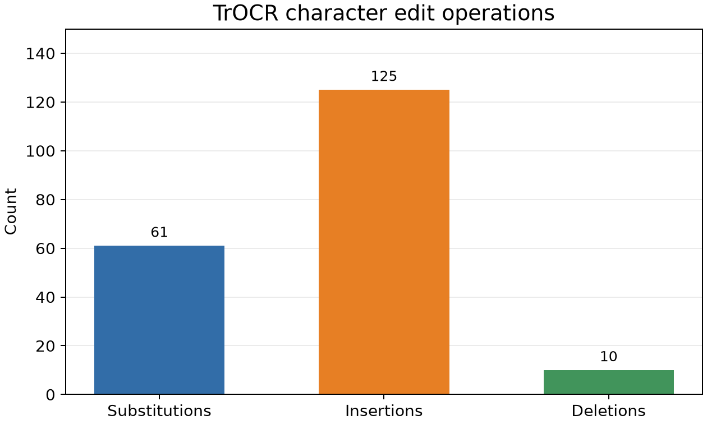
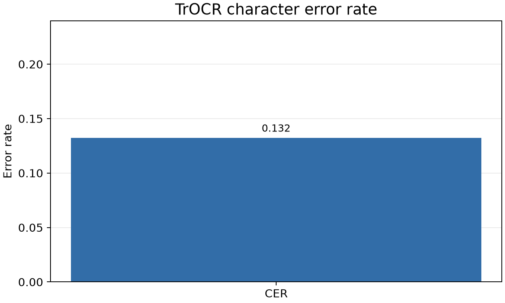
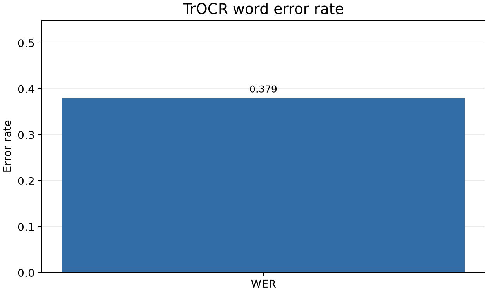
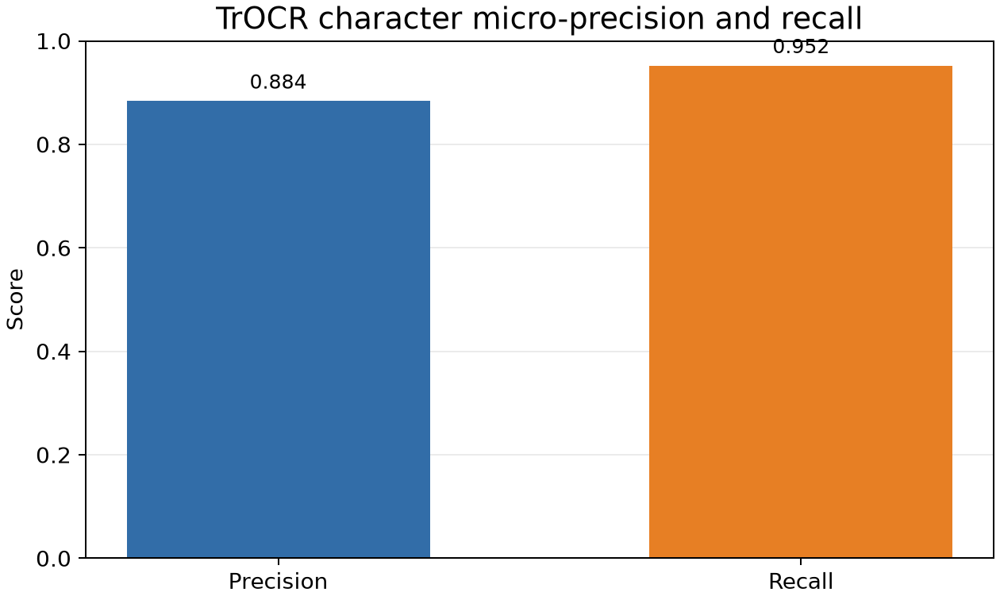
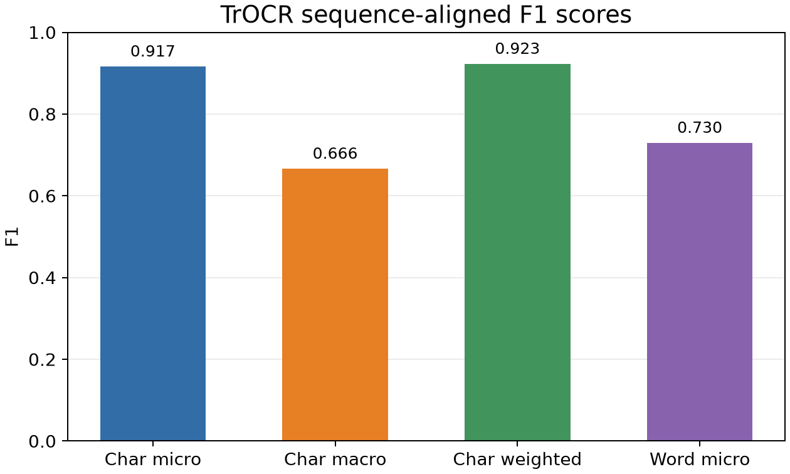
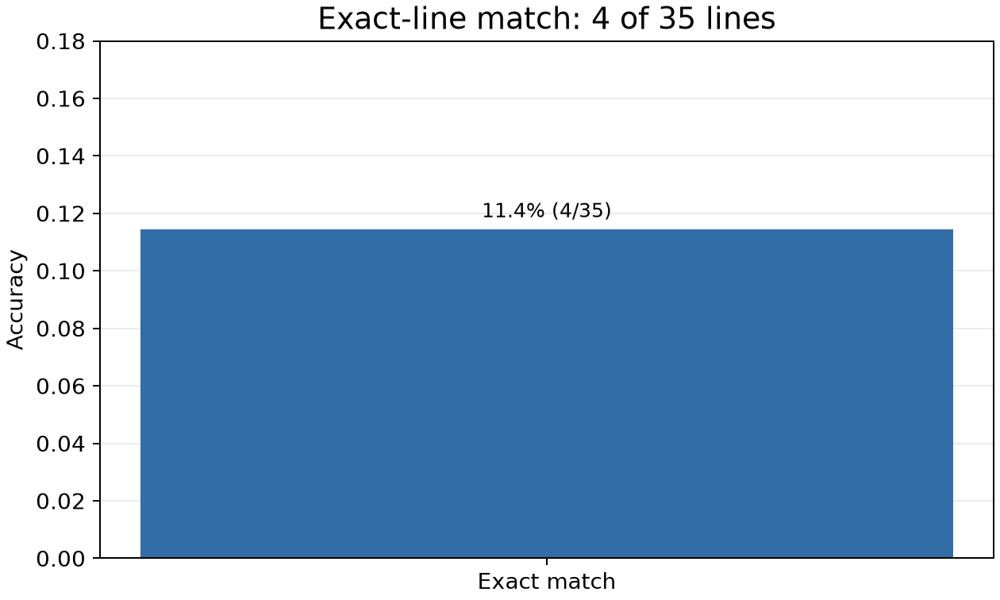
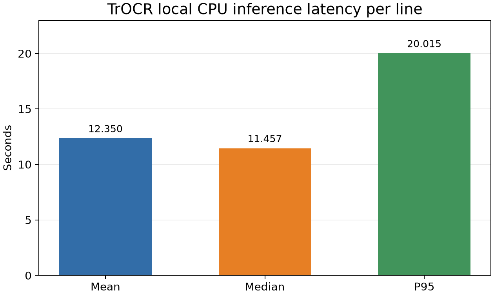

# Tr OCR — Enchanted Ink handwriting evaluation

**Authors:** Arjun C (AM.EN.U4EEE24016) and Anvita Dey (AM.EN.U4EEE24014)  
Electrical and Electronics Department, Amrita Vishwa Vidyapeetham  
**Evaluation date:** 20 November 2026

## Executive summary

The downloaded fine-tuned TrOCR checkpoint transcribed all **35** held-out line images. On this test split it measured **13.2% character error rate (CER)** (bootstrap 95% interval 7.9–21.2%), **37.9% word error rate (WER)** (27.0–50.6%), and **4/35 exact line matches (11.4%)**. Character alignment accuracy was 86.8%; word-level recognition remains appreciably harder. These results are from one small line-level split and do not establish writer-independent performance.

## Test-set results

| Metric | Measured result |
|---|---:|
| Test lines with a returned transcript | 35/35 (100.0%) |
| Character error rate | 0.132 (95% bootstrap interval 0.079–0.212) |
| Word error rate | 0.379 (95% bootstrap interval 0.280–0.506) |
| Exact line match | 0.114 (4/35) |
| Character alignment accuracy | 0.868 |
| Character micro / macro / weighted F1 | 0.917 / 0.666 / 0.923 |
| Word micro F1 | 0.730 |
| Mean / median / P95 local inference latency | 12.35 / 11.46 / 20.02 seconds |

CER and WER use Levenshtein edits divided by the number of reference characters and words. The bootstrap intervals resample test lines 1,000 times; they reflect uncertainty across this small set, not performance across writers or all handwriting. The confusion matrix reports aligned character counts for the most frequent reference characters. Its color scale is logarithmic; this is not a percent-normalized matrix.

## Figures

### Character confusion counts



### Error operations



### Character and word quality









### Exact-line results and latency





## Model and training configuration

The report evaluates the Hugging Face checkpoint `seaandsun/enchanted-ink-trocr`, a TrOCR VisionEncoderDecoder fine-tune based on `microsoft/trocr-small-stage1`. The checkpoint’s saved training arguments specify three epochs, batch size four, gradient accumulation four, AdamW with learning rate 1e-5, a linear schedule, FP16, and seed 42. Training used 268 lines, validation 33, and test 35 from the Kaggle English Handwritten Line Dataset. Training and evaluation images are not included in this report package. The available artifacts do not record the training hardware.

## Limitations

- There are only 35 test lines. CER/WER intervals are wide, and exact-line performance is 4 correct lines.
- Writer IDs are unavailable, so the split is not writer-disjoint and handwriting style can overlap across subsets.
- The dataset license is not stated in the manifest. The submitted package contains aggregate metrics and figures, not source images or per-line transcripts.
- Latency reflects this local CPU evaluation environment and is not a general hardware benchmark.
- Confidence calibration, board-command execution success, and user correction effort were not measured in this run.

## Reproduction

The test split is recorded in `evaluation/datasets/kaggle-english-lines-split.csv` (kept local because source-image permissions have not been verified). With the images and dependencies available:

```bash
TROCR_CHECKPOINT=./stylus-model/stylus-finetuned \
TROCR_ALLOW_BASELINE_FALLBACK=false \
./evaluation/.venv/bin/python evaluation/benchmark_htr.py run \
  --manifest evaluation/datasets/kaggle-english-lines-split.csv \
  --models trocr \
  --output "reports/Tr OCR"
```

**Source:** [Kaggle English Handwritten Line Dataset](https://www.kaggle.com/datasets/sushant097/english-handwritten-line-dataset). The held-out sample and split counts are also recorded in `summary.json`. The PNGs are generated directly from the saved per-sample run metrics; no scores or matrix cells were manually adjusted.
